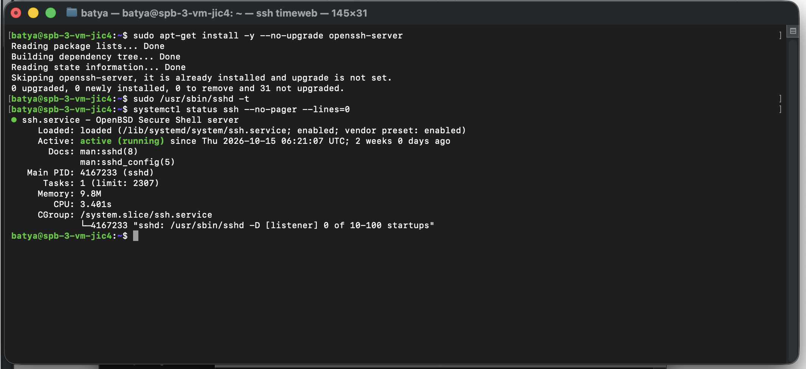
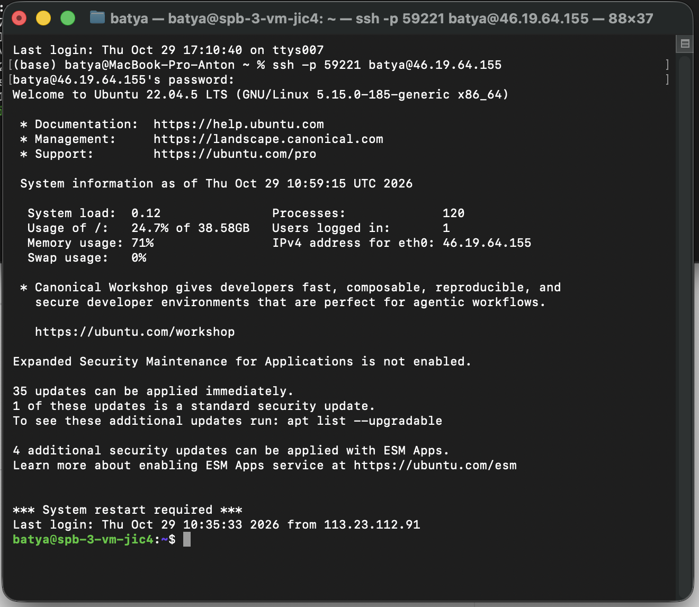
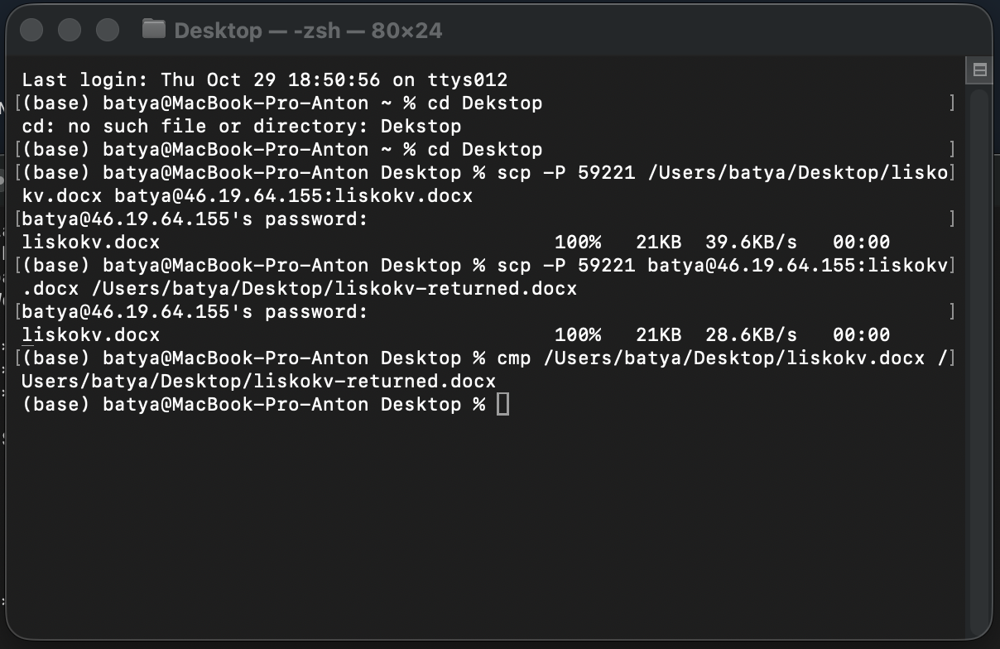
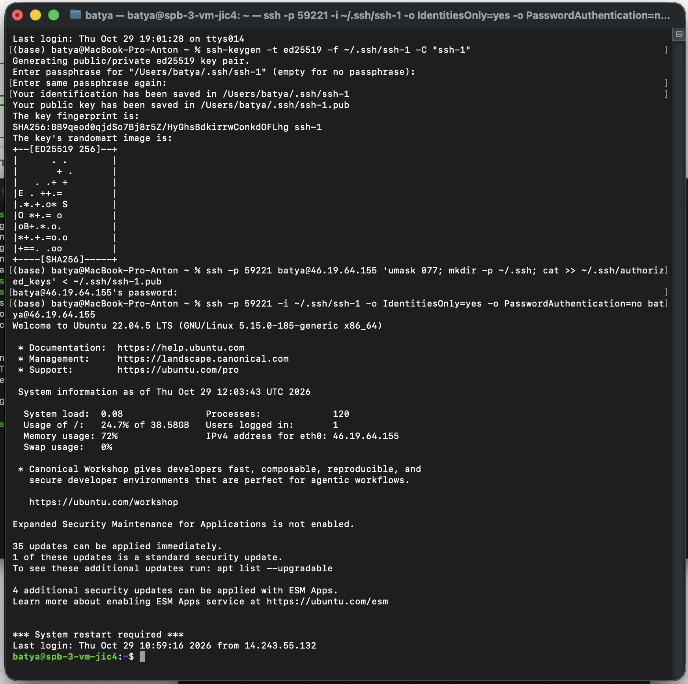

# Практическая работа: SSH

Выполнены первые четыре задания: проверка SSH-сервера, подключение к удалённой машине, передача файлов через SCP и настройка входа по ключу.

Клиент — macOS, сервер — Ubuntu 22.04.5 LTS. Адрес `192.0.2.10`, пользователь `student`, порт `2222` и имя документа в примерах условные.

## 1. Установка и настройка SSH-сервера

Проверено наличие пакета `openssh-server`. Пакет уже был установлен, поэтому повторная установка и обновление не потребовались. Проверены синтаксис конфигурации и состояние службы SSH.

```bash
sudo apt-get install -y --no-upgrade openssh-server
sudo /usr/sbin/sshd -t
systemctl status ssh --no-pager --lines=0
```

**Результат:** конфигурация прошла проверку без ошибок, служба `ssh` находится в состоянии `active (running)`.



## 2. Подключение к удалённому серверу

С Mac выполнено подключение к серверу командой `ssh` с явным указанием имени пользователя, IP-адреса и порта. После ввода пароля открылась командная оболочка Ubuntu.

```bash
ssh -p 2222 student@192.0.2.10
```

**Результат:** SSH-соединение установлено, получен доступ к командной строке удалённого сервера.



## 3. Копирование файлов с помощью SCP

Документ передан с Mac на сервер и скачан обратно под другим именем. После передачи исходный и полученный файлы сравнены командой `cmp`.

```bash
scp -P 2222 ./document.docx student@192.0.2.10:document.docx
scp -P 2222 student@192.0.2.10:document.docx ./document-returned.docx
cmp ./document.docx ./document-returned.docx
```

**Результат:** обе передачи завершены на 100%. Команда `cmp` не вывела различий: содержимое файлов совпадает.



## 4. Работа с ключами SSH

На Mac создана пара ключей Ed25519: приватный ключ `~/.ssh/ssh-1` и публичный ключ `~/.ssh/ssh-1.pub`. Публичный ключ добавлен в `~/.ssh/authorized_keys` на сервере. Затем проверено подключение с явным указанием ключа и отключённой парольной аутентификацией на стороне клиента.

```bash
ssh-keygen -t ed25519 -f ~/.ssh/ssh-1 -C "ssh-1"
ssh -p 2222 student@192.0.2.10 'umask 077; mkdir -p ~/.ssh; cat >> ~/.ssh/authorized_keys' < ~/.ssh/ssh-1.pub
ssh -p 2222 -i ~/.ssh/ssh-1 -o IdentitiesOnly=yes -o PasswordAuthentication=no student@192.0.2.10
```

**Результат:** вход по SSH-ключу выполнен успешно. Для этого подключения пароль учётной записи сервера не потребовался.


